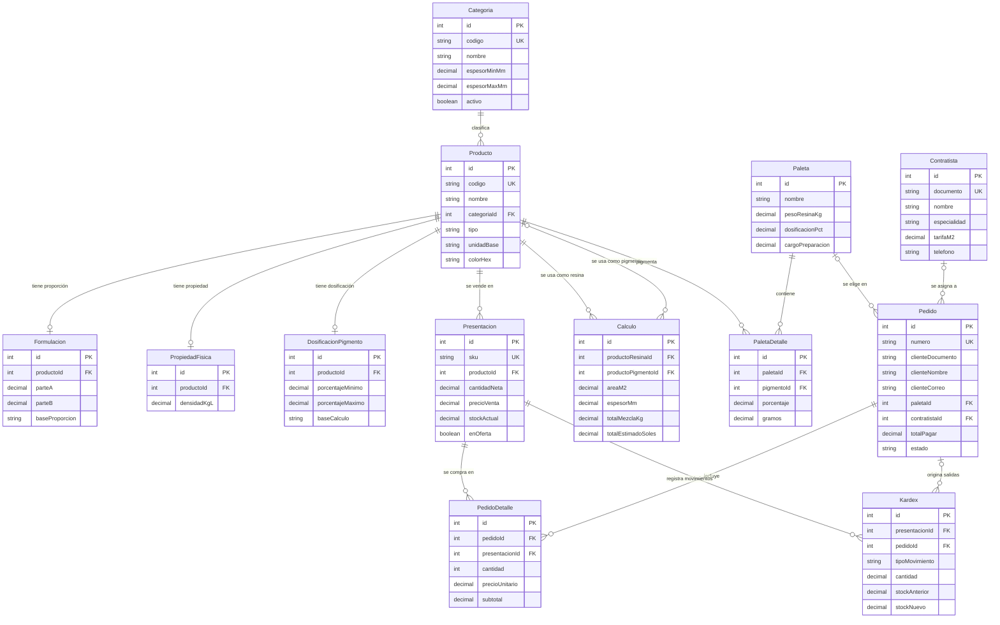

# Data Architecture & Persistence Layer

La capa de datos usa una base PostgreSQL compartida y modelos Django por módulo. Las proporciones, densidades y dosificaciones se guardan en tablas propias relacionadas con el material del catálogo.

## Database Configuration

| Service/Module | DB Type | Profile | Driver | Connection | Migration Tool |
|---|---|---|---|---|---|
| Proyecto Django | PostgreSQL 16 | Único entorno configurado | `psycopg2-binary` | Base `business_db`; host lógico `db`; puerto interno `5435`; conexión persistente de 60 s | Django `manage.py migrate`; SQL de inicialización en `database/init/` |
| Django auth/admin/sessions | PostgreSQL 16 compartido | Mismo entorno | `psycopg2-binary` | Mismo alias/base | Migraciones Django disponibles y aplicadas |

No se detectó una segunda base para desarrollo o pruebas. Tras la normalización del catálogo, el esquema activo tiene 23 tablas y 2 vistas en `public`. Las aplicaciones de negocio ahora tienen migraciones Django. Para preservar el volumen existente, las migraciones iniciales se marcaron como aplicadas cuando sus tablas ya estaban creadas; una migración posterior copió los datos técnicos a sus tablas propias y retiró las columnas antiguas de `productos`.

Los datos de conexión provienen de variables de entorno. No se incluyen aquí contraseñas ni otros secretos. No se encontró una herramienta de migración distinta de Django y del SQL inicial. La generación de precio de presentación existe como columna calculada en PostgreSQL y como propiedad calculada en el modelo ORM.

## Data Ownership per Service

| Service | Tables Owned | ORM Framework | Caching | Notes |
|---|---|---|---|---|
| `apps.catalog` | `categorias`, `productos`, `presentaciones`, `kardex`, `formulaciones`, `propiedades_fisicas`, `dosificaciones_pigmento` | Django ORM | Ninguna detectada | Las características técnicas están separadas de la identificación comercial. |
| `apps.calculator` | `calculos` | Django ORM; consulta `Producto` de `apps.catalog` | Ninguna detectada | Conserva medidas, valores calculados y referencias a resina y pigmento. |
| `apps.contractors` | `contratistas` | Django ORM | Ninguna detectada | Instaladores asociados opcionalmente a pedidos. |
| `apps.palette_lab` | `paletas`, `paleta_detalles` | Django ORM | Ninguna detectada | Recetas de color y cantidades de pigmentos. |
| `apps.sales` | `pedidos`, `pedido_detalles` | Django ORM | Ninguna detectada | Recordatorios y métricas protegidos para personal autenticado. |
| Django auth/admin | `auth_*`, `django_admin_log`, `django_content_type`, `django_migrations`, `django_session` | Django ORM | Ninguna detectada | Un usuario de autenticación estaba registrado; no se encontraron modelos de perfiles de negocio propios. |
| Vistas SQL | `vista_catalogo_completo`, `vista_auditoria_kardex` | Vistas PostgreSQL | No aplica | Proyecciones de lectura, no tablas base. |

El SQL inicial crea el esquema base y sus datos iniciales en una instalación vacía; las migraciones Django versionan los cambios posteriores.

## Entity Model

### Modelos ORM encontrados

- `Categoria` (`apps/catalog/models.py`): `codigo`, `nombre`, `espesor_min_mm`, `espesor_max_mm`, `activo`.
- `Producto` (`apps/catalog/models.py`): `codigo`, `nombre`, `descripcion`, `categoria`, `tipo`, `unidad_base`, `color_hex`, `activo`, `creado_en`.
- `Formulacion` (`apps/catalog/models.py`): `producto`, `parte_a`, `parte_b`, `base_proporcion`.
- `PropiedadFisica` (`apps/catalog/models.py`): `producto`, `densidad_kg_l`.
- `DosificacionPigmento` (`apps/catalog/models.py`): `producto`, `porcentaje_minimo`, `porcentaje_maximo`, `base_calculo`.
- `Presentacion` (`apps/catalog/models.py`): `sku`, `producto`, `nombre_envase`, `unidad_medida`, `cantidad_neta`, `volumen_litros`, `resina_a_kg`, `catalizador_b_kg`, `costo_importacion`, `costo_operativo`, `margen_pct`, `stock_actual`, `en_oferta`, `activo`. Precio y precio unitario se exponen como propiedades Python.
- `Kardex` (`apps/catalog/models.py`): `presentacion`, `tipo_movimiento`, `cantidad`, `stock_anterior`, `stock_nuevo`, `motivo`, `fecha`. `registrar_movimiento` usa `transaction.atomic` y bloquea la presentación con `select_for_update`.
- `Calculo` (`apps/calculator/models.py`): `producto_resina`, `producto_pigmento` opcional, `area_m2`, `espesor_mm`, `superficie`, `merma_pct`, `volumen_litros`, `total_mezcla_kg`, `resina_a_kg`, `catalizador_b_kg`, `pigmento_gramos`, `total_estimado_soles`, `creado_en`.

### Modelos de semana 4

`Paleta` y `PaletaDetalle` almacenan recetas y componentes; `Contratista` almacena instaladores; `Pedido` y `PedidoDetalle` almacenan pedidos y sus importes/líneas. Las vistas de recordatorios y métricas se encuentran en `apps/sales/views.py`.

### Diagrama del esquema de negocio actual

<!-- mermaid-checked: every attribute is `<type> <name> [<key>] ["<description>"]` with at most one of PK/FK/UK, no \n in descriptions, no {} in descriptions, every relationship label is double-quoted -->

La base incluye además las tablas estándar de autenticación y administración de Django. `django.contrib.auth` guarda contraseñas como hashes; la configuración inspeccionada no evidencia cifrado de columnas ni enmascaramiento específico.

## Key Repository Methods

No se encontraron interfaces de repositorio separadas. El acceso a datos se realiza con QuerySets y managers de Django.

| Service | Repository | Notable Methods | Purpose |
|---|---|---|---|
| `apps.catalog` | `PresentacionQuerySet` (`apps/catalog/managers.py`) | `disponibles()`, `por_categoria(codigo_cat)`, `en_oferta()` | Filtrar presentaciones activas por estado, categoría y marca de oferta. |
| `apps.catalog` | `Presentacion.objects` | `obtener_presentaciones_catalogo(categoria_codigo, solo_ofertas)`, `obtener_resinas_calculadora()`, `obtener_pigmentos_calculadora()` en `apps/catalog/selectors.py` | Consultas de catálogo y selección de productos usados por la calculadora. |
| `apps.catalog` | `Kardex` (`apps/catalog/models.py`) | `registrar_movimiento(presentacion_id, tipo, cantidad, motivo)` | Actualizar existencias y crear el movimiento dentro de una transacción. |
| `apps.calculator` | `Calculo.objects` | No hay métodos de consulta personalizados detectados. | El historial se consulta desde el ORM y la lógica de cálculo crea registros directamente. |
| `apps.sales` | `Pedido.objects` | QuerySets para fecha de seguimiento, estado e importes | Proveer listados de recordatorios y métricas. |
| `apps.palette_lab` | `Paleta.objects` | `prefetch_related("pigmentos__pigmento")` en `lista_paletas` | Cargar recetas y pigmentos con consultas agrupadas. |

## Caching Strategy

No se detectaron proveedores de caché, configuración TTL, políticas de desalojo, caché de consultas ni decoradores de caché. Las sesiones de Django se persisten en la tabla `django_session`; esto es almacenamiento de sesión, no una estrategia de caché.

## Data Ownership Boundaries

Actualmente todas las tablas de negocio y de Django residen en la misma base PostgreSQL. `catalog`, `calculator`, `palette_lab`, `contractors` y `sales` consultan por relaciones ORM directas. No se observó CQRS, base aislada por servicio, broker ni acceso entre servicios por API.

El esquema mantiene precio calculado y existencias actuales en presentaciones y un historial de movimientos en `kardex`. El detalle del pedido contiene precio unitario y subtotal, pero no almacena snapshots de nombre/SKU/promoción/composición del kit. No existen tablas de proveedores, compras/recepciones, pagos, ofertas con vigencia, carritos ni clientes separados.

### Data Classification & Sensitivity

| Entity | Sensitive Fields | Classification (PII/PHI/PCI/None) | Controls in Place |
|---|---|---|---|
| `auth_user` | `username`, `email`, nombres | PII | Django almacena el hash de contraseña; no se encontró evidencia de cifrado de campos o enmascaramiento específico. |
| `Pedido` | `cliente_documento`, `cliente_nombre`, `cliente_correo` | PII | Recordatorios y métricas restringidos a personal autenticado; no se detectó cifrado de columnas. |
| `Contratista` | `documento`, `nombre`, `telefono` | PII | Administración requiere cuenta del personal; no se detectó cifrado de columnas. |
| `PedidoDetalle`, `Presentacion`, `Kardex` | precios, cantidades y movimientos | None | Datos comerciales; las credenciales se obtienen del entorno, no de estas entidades. |
| Entidades de pago | No existen en el esquema actual | PCI no detectado | No hay datos de tarjeta ni integración de Stripe observados. |
