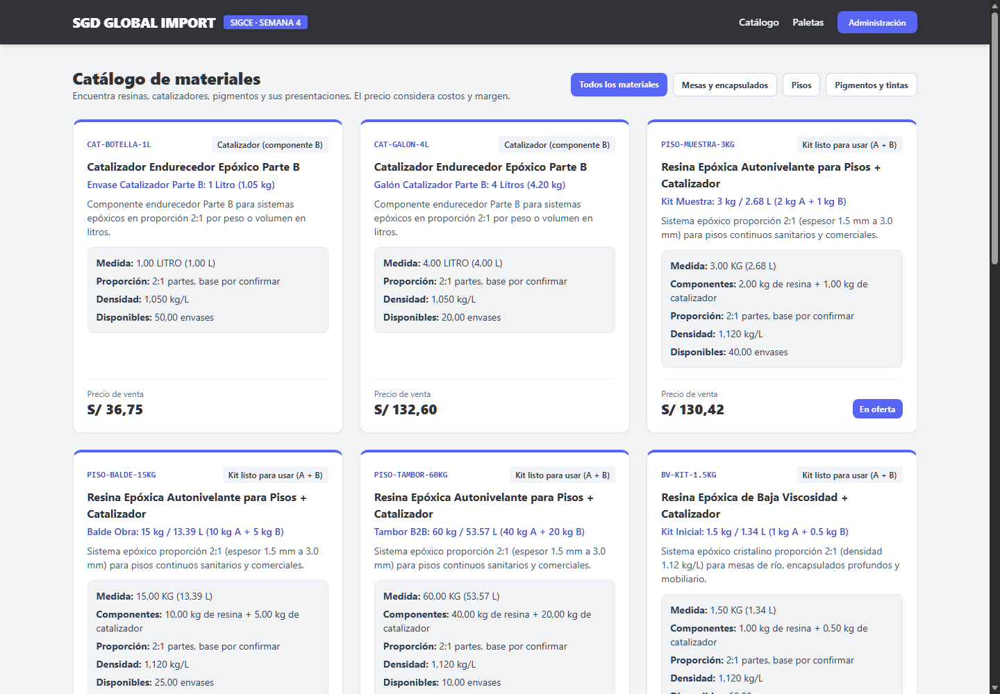

# Entregable 1 — Documentación y evidencias

**Proyecto:** Sistema de Gestión y Comercialización Epóxica (SIGCE - SGD)  
**Fecha de revisión:** 28 de octubre de 2026  
**Responsabilidad según el cronograma:** documentación y pruebas — Cruzado Pacheco Antoni Poe.

## 1. Propósito y alcance

Este informe organiza la evidencia de la responsabilidad asignada para el Entregable 1 y contrasta el cronograma del documento de avance con el estado comprobable del sistema. Es un complemento técnico: el documento académico de referencia sigue siendo [Avance E-business-2.pdf](../Avance%20E-business-2.pdf) y no se reemplaza ni se vuelve a copiar aquí.

Según la semana 1 del cronograma, se entrega el documento completo del negocio, con estudio de mercado, PESTEL, FODA, Canvas, requerimientos, actores y procesos, y se deja configurado el seguimiento en GitHub Actions. El mismo entregable incluye Docker/PostgreSQL, modelos y fórmula de cálculo, catálogo con filtros y formulario interactivo de calculadora.

## 2. Lista de comprobación de mi responsabilidad

| Compromiso del cronograma | Evidencia actual | Estado |
|---|---|---|
| Documento académico: producto/mercado, PESTEL, FODA y Canvas | Secciones 1–3 del PDF de avance (págs. 2–5). | Documentado en el PDF base |
| Requerimientos y justificación | Sección 4 del PDF (págs. 5–8). | Documentado en el PDF base |
| Actores y procesos | Secciones 5–6 del PDF (págs. 8–11). | Documentado en el PDF base |
| Configurar seguimiento automatizado | [Workflow de Django CI](../.github/workflows/django-ci.yml): PostgreSQL 16, `manage.py check` y `manage.py test --verbosity 2` en cada `push` y `pull_request`. | Configurado; falta adjuntar evidencia de una ejecución en GitHub |
| Documentar y ejecutar pruebas | La última ejecución registrada de Django aprobó 14 pruebas. | Aprobadas localmente; no equivale a una ejecución remota de Actions |

El PDF está firmado por el equipo e incluye los apartados académicos pedidos. Para completar la evidencia individual de participación, adjuntar también el enlace o captura del historial de GitHub/Google Sheets que muestre las tareas realizadas por cada integrante; no se presume ese registro porque no está disponible en este espacio de trabajo.

## 3. Progreso de software según el cronograma

Las fechas y compromisos se toman del apartado 7 del PDF. El estado describe lo verificado en el código y en el entorno disponible; no sustituye la demostración del equipo.

| Hito | Alcance del cronograma | Estado comprobado |
|---|---|---|
| Semana 1 — mié. 28 oct. | Documento y Actions; base Docker/PostgreSQL, catálogo, productos/colorantes, fórmula de cálculo, filtros y formulario de calculadora. | Docker, PostgreSQL, catálogo y fórmula están implementados. Hay pruebas automatizadas; la calculadora se conserva, pero en la interfaz actual su ruta antigua redirige al catálogo. La comprobación remota de Actions aún no está adjunta. |
| Semana 2 — mié. 4 nov. | Carrito, pago de prueba, proforma y movimiento automático de existencias. | Pendiente de verificación funcional; la existencia de modelos de pedidos no demuestra por sí sola el flujo completo de compra. |
| Semana 3 — mié. 11 nov. | Contratistas, descuento por contratación y selección en la interfaz. | Hay modelo/app de instaladores; el flujo de selección y aplicación automática del descuento no está certificado en esta revisión. |
| Semana 4 — mié. 18–25 nov. | Laboratorio de color, preparación, recordatorios, métricas e informe final. | Existen páginas y pruebas para paletas, recordatorios y métricas. Las funciones internas requieren sesión de personal; no se declara validada una operación completa autenticada en navegador. |

El código incluye trabajo de semanas posteriores antes de la fecha planificada; eso no cambia los hitos del cronograma ni significa que todos sus criterios de aceptación ya estén demostrados.

## 4. Evidencia del despliegue actual

La aplicación se ejecuta en Docker Compose: Django en el puerto local 8000, PostgreSQL 16 (saludable), Tailwind y Cloudflare Tunnel. Al momento de esta captura, los cuatro servicios estaban activos y el túnel respondía HTTP 200 para `/` y `/paletas/`.

| Evidencia | Resultado |
|---|---|
| Catálogo local | HTTP 200 en `http://localhost:8000/`. |
| Catálogo por Cloudflare Quick Tunnel | HTTP 200; [URL temporal verificada](https://constitute-never-temperatures-authors.trycloudflare.com), válida al momento de esta revisión. |
| Recetas de color por el túnel | HTTP 200 en `/paletas/`. |
| Pruebas Django | `docker compose exec -T web python manage.py test --verbosity 1`: 14 aprobadas, 0 fallidas (28 oct. 2026). |
| Comprobaciones de configuración | `manage.py check` sin errores; `makemigrations --check --dry-run` sin cambios pendientes. |

### Capturas

*Figura 1. Catálogo accesible por HTTPS en la URL temporal de Cloudflare. La dirección del Quick Tunnel puede cambiar al reiniciar.*

*Figura 2. La misma aplicación servida localmente por Django.*

El Quick Tunnel es gratuito y útil para la demostración, pero temporal. El equipo debe seguir encendido, conectado a internet y con Docker activo. Estas capturas prueban disponibilidad al momento de la revisión, no disponibilidad continua ni un despliegue de producción.

## 5. Pruebas y alcance de la evidencia

- Suite Django: **14 pruebas aprobadas** en la última ejecución registrada, incluyendo catálogo, filtros, calculadora, fórmulas técnicas, recetas, recordatorios y métricas.
- Django: comprobación del proyecto sin errores y migraciones sin diferencias pendientes.
- Frontend: compilación minificada de Tailwind completada.
- HTTP: catálogo y paletas con respuesta 200; el formulario protegido de recetas redirige al inicio de sesión si la visita no está autenticada.
- GitHub Actions: el archivo de workflow está presente y configura pruebas con PostgreSQL 16; no se encontró evidencia de una ejecución remota de GitHub en esta revisión.

Las pruebas anteriores son evidencia reproducible del código, pero no reemplazan una prueba de aceptación con el profesor. La interfaz actual tampoco incluye la calculadora porque se ocultó temporalmente en una iteración posterior; si la sustentación exige demostrar RF-03 en pantalla, hay que habilitar un acceso demostrativo o documentar la ruta/decisión antes de presentar.

## 6. Pendientes antes de presentar

1. Abrir la pestaña **Actions** del repositorio y guardar una captura de una ejecución verde del workflow; si aún no existe, publicar el workflow y corregir cualquier fallo hasta obtenerla.
2. Completar o adjuntar el registro de contribuciones por integrante solicitado por el cronograma (GitHub/Google Sheets).
3. Confirmar con el equipo si la calculadora debe permanecer oculta en la demostración del Entregable 1; la ruta actual redirige al catálogo.
4. No presentar el Quick Tunnel como dominio permanente ni la integración Stripe como implementada.

## 7. Fuente

- [Avance E-business-2.pdf](../Avance%20E-business-2.pdf), especialmente las secciones 1–7 y el cronograma de la semana 1 (págs. 2–13).
- [Workflow de CI](../.github/workflows/django-ci.yml).
- [Documentación técnica del Entregable 1](../specs/01-entregable-semana-1.md).
- [Entregable de semana 4](../specs/04-entregable-semana4.md).
